# 음악으로 먹고사는 사람들 — 단원 수업 설계

> **음악 산업 12개 분야를 조사하여 1분으로 말하기**
> 중학교 3학년 음악(생활화) · 4차시 · 순천승평중학교 유정준

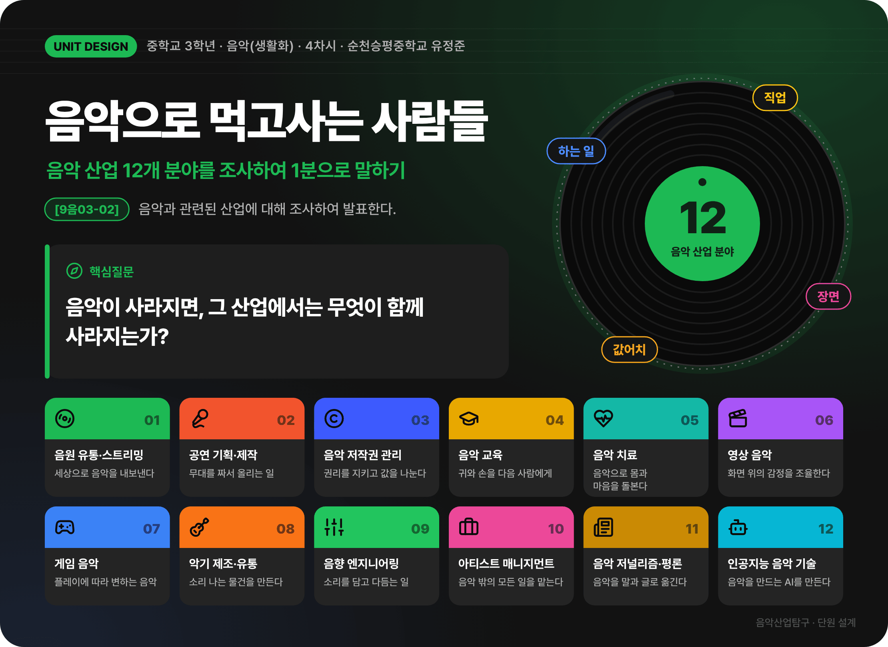

| 성취기준 | 핵심질문 | 총괄평가 과제 |
| --- | --- | --- |
| **[9음03-02]** 음악과 관련된 산업에 대해 조사하여 발표한다. | 음악이 사라지면, 그 산업에서는 무엇이 함께 사라지는가? | 「음악으로 먹고사는 사람들」 음악 산업 1분 리포트 (온라인 조사 활동지 + 1분 발표 영상) |

🔗 수업 플랫폼(학생용): <https://edunity21.github.io/musetech/>

---

## 목차

1. [단원 설계 개요](#1-단원-설계-개요)
   - [단원 설계 의도](#단원-설계-의도)
2. [단원 목표 설정](#2-단원-목표-설정)
3. [단원 평가 계획](#3-단원-평가-계획)
   - [성취기준 및 성취수준 분석](#3-1-성취기준-및-성취수준-분석)
   - [총괄평가 과제 개발 (GRASPS)](#3-2-총괄평가-과제-개발-grasps)
   - [루브릭](#3-3-루브릭)
4. [단원 수업 계획](#4-단원-수업-계획)
5. [본시 수업 설계](#5-본시-수업-설계)

---

## 1. 단원 설계 개요

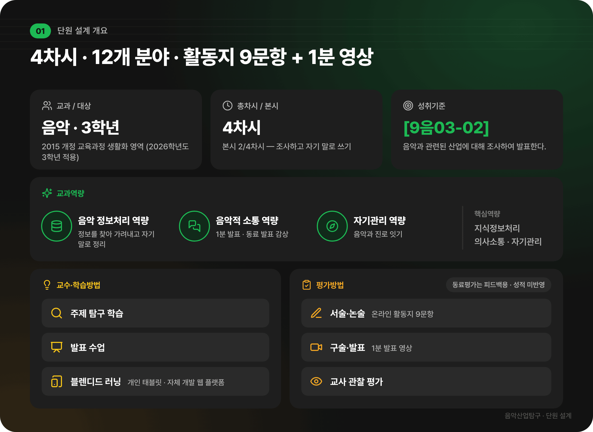

| 항목 | 내용 |
| --- | --- |
| 교사명 | 유정준 (순천승평중학교) |
| 교과(과목) / 대상 / 총차시 | 음악 / 3학년 / 4차시 |
| 주제 | 음악으로 먹고사는 사람들 ― 음악 산업 12개 분야를 조사하여 1분으로 말하기 |
| 교과역량 (핵심역량) | **교과역량** 음악 정보처리 역량(정보를 찾아 가려내고 자기 말로 정리) · 음악적 소통 역량(1분 발표, 동료 발표 감상) · 자기관리 역량(음악과 진로 잇기)<br>**핵심역량** 지식정보처리 · 의사소통 · 자기관리 |
| 성취기준 | [9음03-02] 음악과 관련된 산업에 대해 조사하여 발표한다.<br>2015 개정 교육과정 생활화 영역 (2026학년도 3학년 적용) |
| 교수·학습방법 | 주제 탐구 학습, 발표 수업, 블렌디드 러닝(개인 태블릿 · 자체 개발 웹 플랫폼) |
| 평가방법 | 서술·논술(온라인 활동지 9문항), 구술·발표(1분 발표 영상), 교사 관찰 평가 / 동료평가는 피드백용(성적 미반영) |

### 단원 설계 의도

#### ◈ 왜 가르치는가

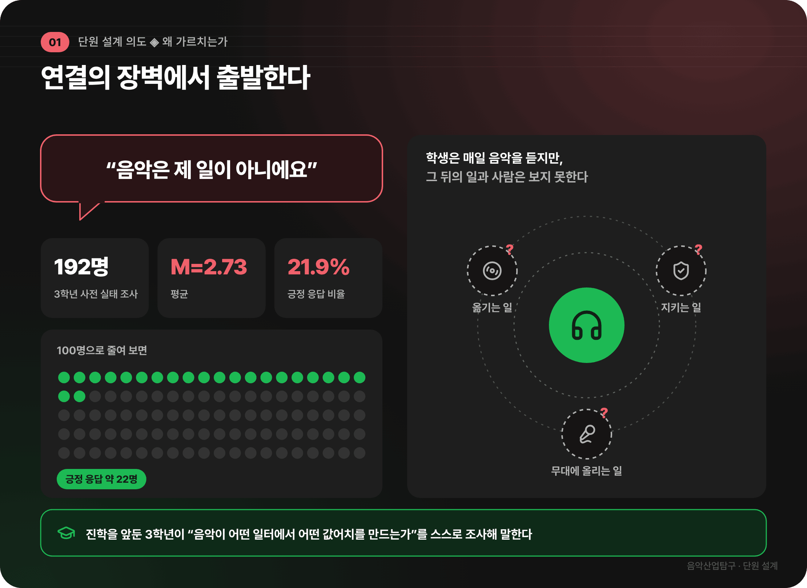

3학년 사전 실태 조사(192명)에서 “음악은 제 일이 아니에요”라는 연결의 장벽이 드러났다(M=2.73, 긍정 21.9%). 학생은 매일 음악을 듣지만, 그 음악을 옮기고 지키고 무대에 올리는 일과 사람은 보지 못한다. 진학을 앞둔 3학년이 “음악이 어떤 일터에서 어떤 값어치를 만드는가”를 스스로 조사해 말하는 경험은, 생활화 영역이 겨냥하는 ‘음악의 활용’을 자기 삶의 언어로 옮기는 일이다.

#### ◈ 무엇이 도달의 증거인가

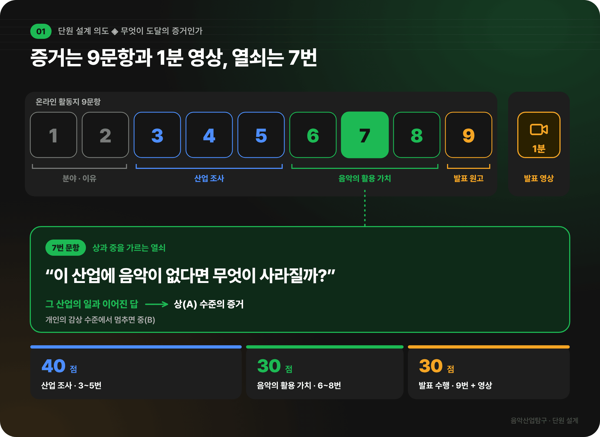

온라인 활동지 9문항과 1분 발표 영상. 산업 조사(3~5번), 음악의 활용 가치(6~8번), 발표 원고(9번)를 나누어 보며, 특히 7번 “이 산업에 음악이 없다면 무엇이 사라질까?”에 그 산업의 일과 이어진 답을 쓰면 상(A) 수준의 증거로 본다.

#### ◈ 어떤 경로로 가는가

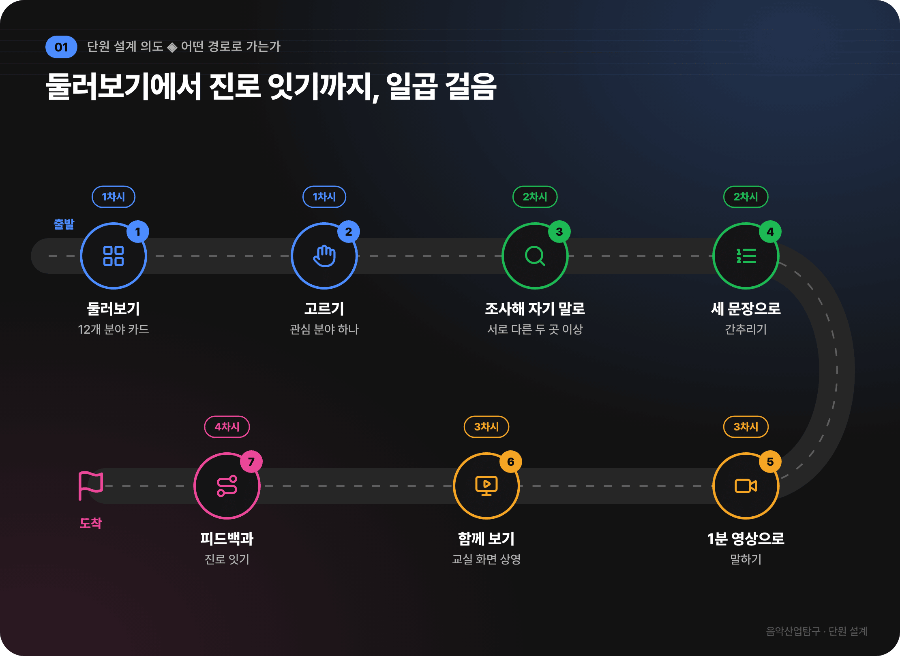

둘러보기(12개 분야 카드) → 고르기 → 서로 다른 두 곳 이상에서 조사해 자기 말로 쓰기 → 세 문장으로 간추리기 → 1분 영상으로 말하기 → 함께 보기 → 피드백과 진로 잇기.

#### ◈ 어떤 바람직한 어려움을 겪게 하는가

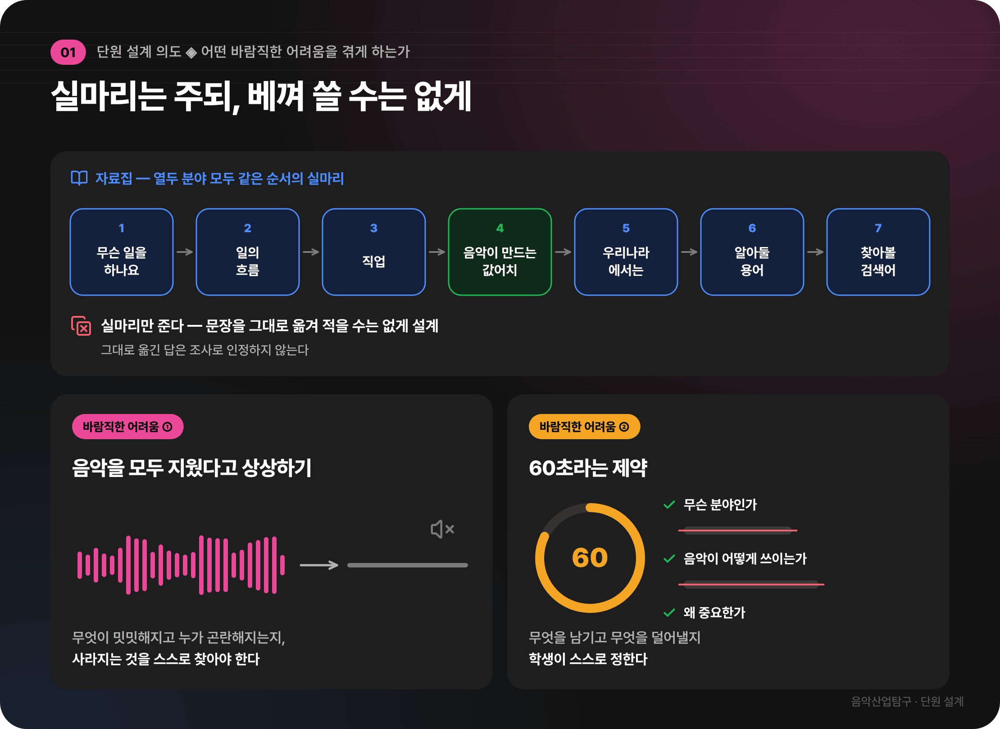

자료집은 분야마다 ‘무슨 일을 하나요 → 일의 흐름 → 직업 → 음악이 만드는 값어치 → 우리나라에서는 → 알아둘 용어 → 찾아볼 검색어’의 같은 순서로 실마리만 주고, 문장을 그대로 옮겨 적을 수는 없게 설계하였다. 학생은 음악을 모두 지웠다고 상상하며 사라지는 것을 찾아야 하고, 60초라는 제약 안에서 무엇을 덜어낼지 스스로 정해야 한다.

<p align="center">
  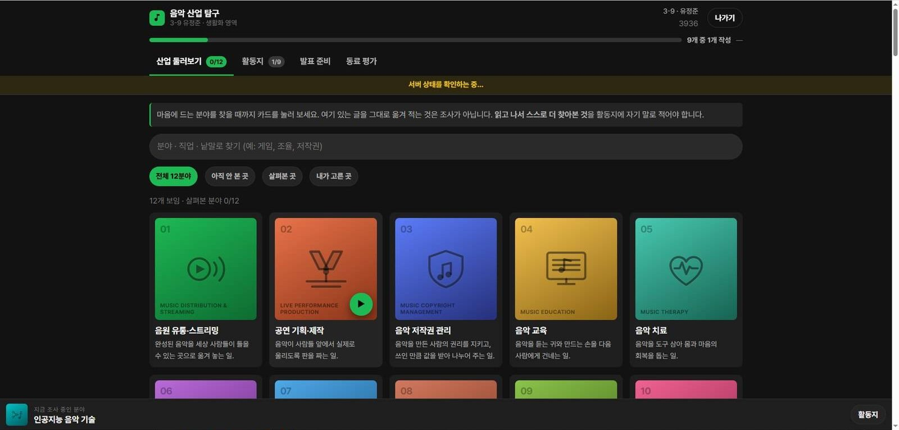
  <br><sub>플랫폼 [산업 둘러보기] — 12개 분야 카드에서 실마리를 잡는다</sub>
</p>

#### ◈ 피드백은 어떻게 하는가

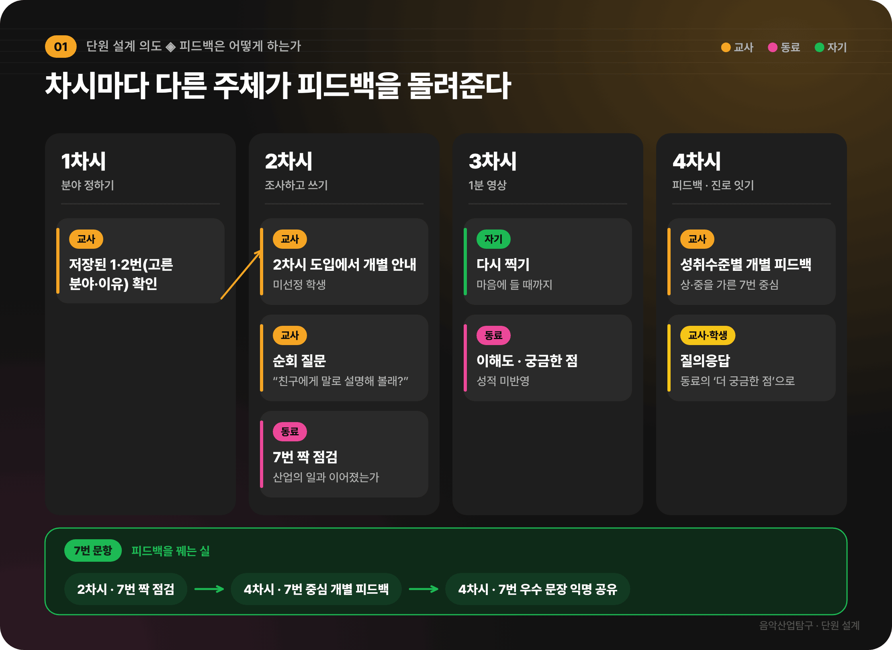

1차시 저장본을 교사가 확인해 2차시 도입에서 개별 안내 → 2차시 순회 질문(“친구에게 말로 설명해 볼래?”)과 7번 짝 점검 → 3차시 다시 찍기(자기)와 이해도·궁금한 점(동료) → 4차시 성취수준별 개별 피드백과 질의응답.

#### ◈ 평가 운영의 딜레마

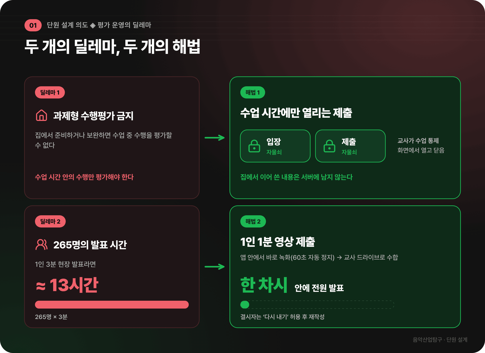

과제형 수행평가 금지 요건은 ‘수업 시간에만 열리는 제출’로, 265명의 발표 시간(1인 3분이면 약 13시간)은 ‘1인 1분 영상 제출’로 풀었다.

<p align="center">
  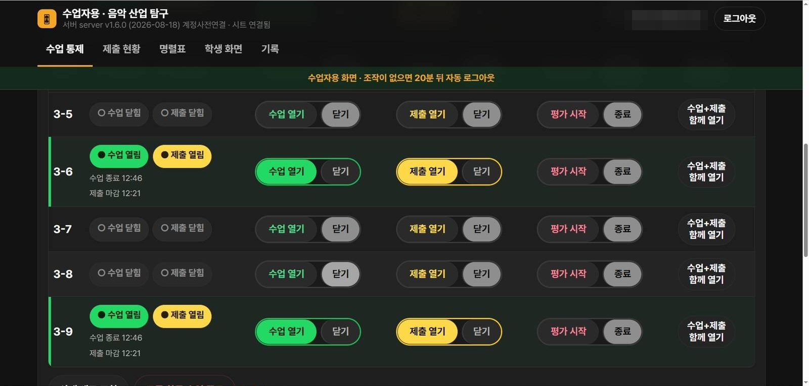
  <br><sub>교사용 화면 [수업 통제] — 학급별로 수업과 제출을 열고 닫는다</sub>
</p>

---

## 2. 단원 목표 설정

### 교육과정

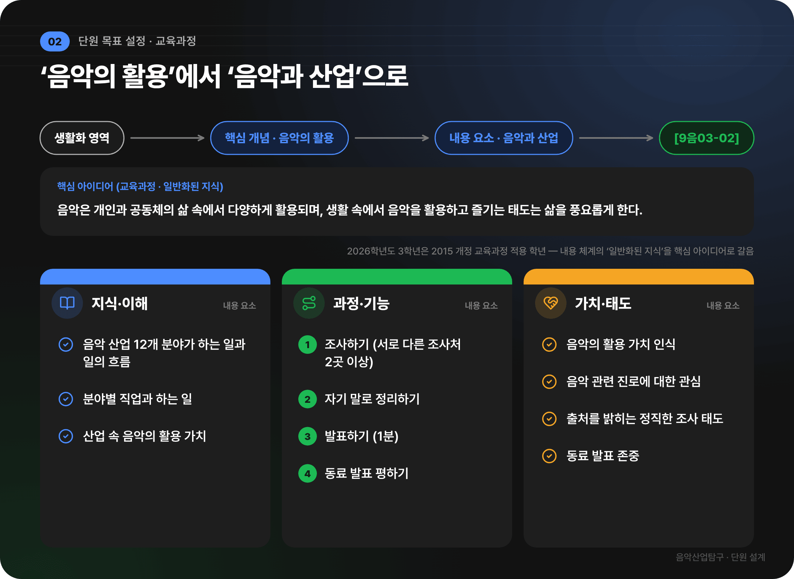

| 구분 | 내용 |
| --- | --- |
| 핵심 아이디어 | [생활화] 핵심 개념 ‘음악의 활용’ · 내용 요소 ‘음악과 산업’<br>음악은 개인과 공동체의 삶 속에서 다양하게 활용되며, 생활 속에서 음악을 활용하고 즐기는 태도는 삶을 풍요롭게 한다.<br><sub>※ 2026학년도 3학년은 2015 개정 교육과정 적용 학년으로, 내용 체계의 ‘일반화된 지식’을 핵심 아이디어로 갈음함</sub> |
| 성취기준 | [9음03-02] 음악과 관련된 산업에 대해 조사하여 발표한다.<br>· 상: 음악과 관련된 산업과 음악의 활용 가치에 대해 조사하여 발표할 수 있다.<br>· 중: 음악과 관련된 산업에 대해 조사하여 발표할 수 있다.<br>· 하: 음악과 관련된 산업에 대해 발표할 수 있다. |

| 범주 | 내용 요소 |
| --- | --- |
| 지식·이해 | · 음악 산업 12개 분야가 하는 일과 일의 흐름<br>· 분야별 직업과 하는 일<br>· 산업 속 음악의 활용 가치 |
| 과정·기능 | · 조사하기(서로 다른 조사처 2곳 이상)<br>· 자기 말로 정리하기<br>· 발표하기(1분)<br>· 동료 발표 평하기 |
| 가치·태도 | · 음악의 활용 가치 인식<br>· 음악 관련 진로에 대한 관심<br>· 출처를 밝히는 정직한 조사 태도<br>· 동료 발표 존중 |

### 단원 핵심개념 · 핵심 아이디어 · 핵심질문

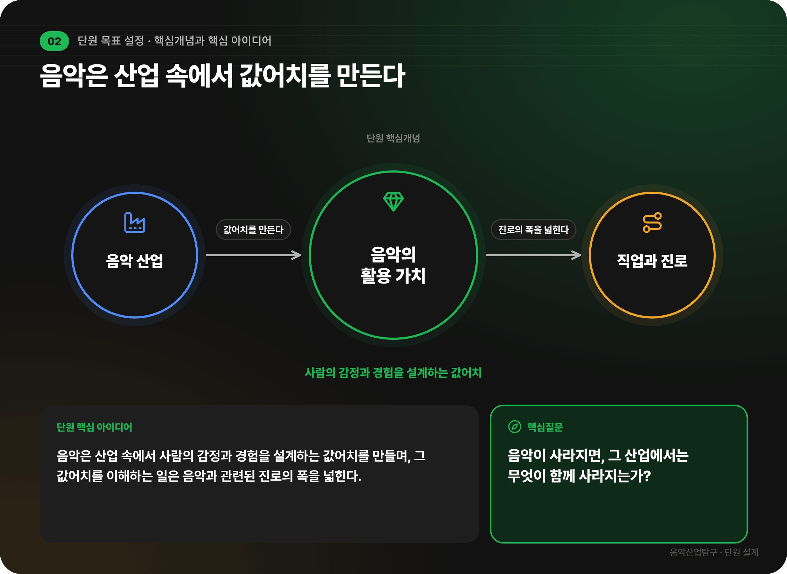

| 구분 | 내용 |
| --- | --- |
| 핵심개념 | 음악 산업 · 음악의 활용 가치 · 직업과 진로 |
| 핵심 아이디어 | 음악은 산업 속에서 사람의 감정과 경험을 설계하는 값어치를 만들며, 그 값어치를 이해하는 일은 음악과 관련된 진로의 폭을 넓힌다. |
| 핵심질문 | **음악이 사라지면, 그 산업에서는 무엇이 함께 사라지는가?** |

### 탐구질문 (사실적 · 개념적 · 논쟁적)

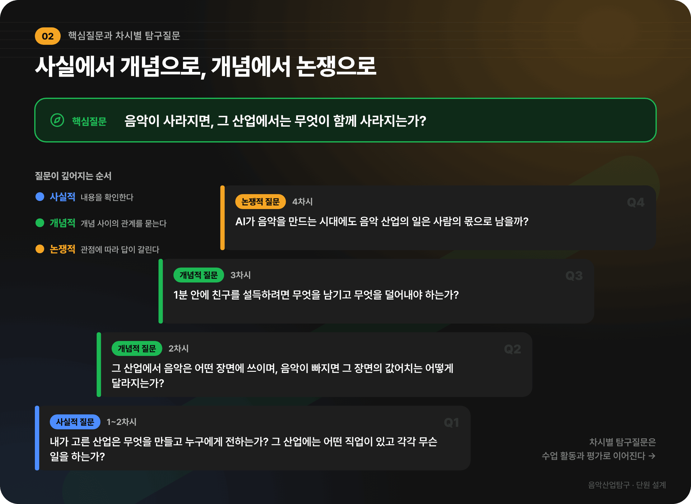

| 유형 | 탐구질문 | 차시 |
| --- | --- | --- |
| 사실적 | 내가 고른 산업은 무엇을 만들고 누구에게 전하는가? 그 산업에는 어떤 직업이 있고 각각 무슨 일을 하는가? | 1~2차시 |
| 개념적 | 그 산업에서 음악은 어떤 장면에 쓰이며, 음악이 빠지면 그 장면의 값어치는 어떻게 달라지는가? | 2차시 |
| 개념적 | 1분 안에 친구를 설득하려면 무엇을 남기고 무엇을 덜어내야 하는가? | 3차시 |
| 논쟁적 | AI가 음악을 만드는 시대에도 음악 산업의 일은 사람의 몫으로 남을까? | 4차시 |

---

## 3. 단원 평가 계획

### 3-1. 성취기준 및 성취수준 분석

> 성취기준 및 성취수준 분석 → 평가 요소 도출/선정 → 평가방법(유형) → 총괄평가 과제

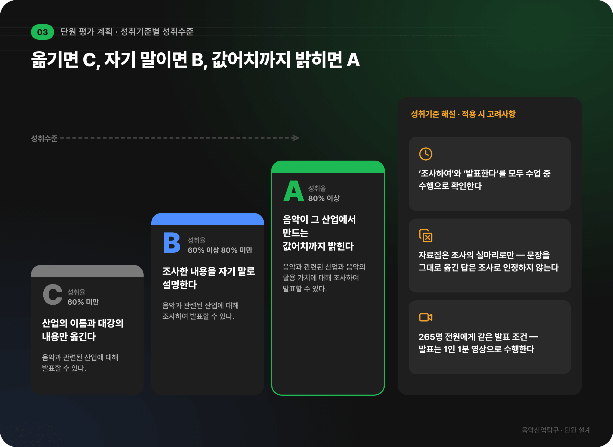

**[9음03-02] 음악과 관련된 산업에 대해 조사하여 발표한다.**

| 성취수준 | 진술 | 성취율 |
| :---: | --- | --- |
| **A** | 음악과 관련된 산업과 음악의 활용 가치에 대해 조사하여 발표할 수 있다. | 80% 이상 |
| **B** | 음악과 관련된 산업에 대해 조사하여 발표할 수 있다. | 60% 이상 80% 미만 |
| **C** | 음악과 관련된 산업에 대해 발표할 수 있다. | 60% 미만 |

**성취기준 해설 (적용 시 고려사항)**
‘조사하여’와 ‘발표한다’를 모두 수업 중 수행으로 확인한다. 산업의 이름과 대강의 내용만 옮기는 수준(C), 조사한 내용을 자기 말로 설명하는 수준(B), 음악이 그 산업에서 만드는 값어치까지 밝히는 수준(A)을 가른다.
자료집은 조사의 실마리로만 쓰게 하고 문장을 그대로 옮긴 답은 조사로 인정하지 않으며, 265명 전원에게 같은 발표 조건을 주기 위해 발표는 1인 1분 영상으로 수행한다.

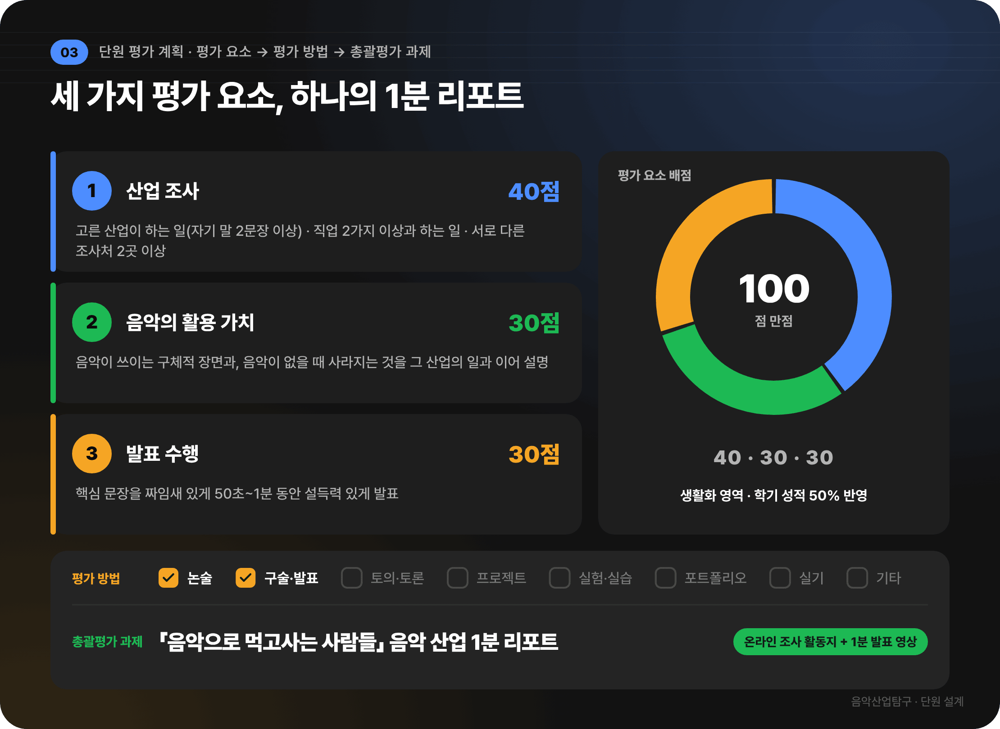

| 범주 | 내용 요소 |
| --- | --- |
| 지식·이해 | 음악 산업 12개 분야(음원 유통·스트리밍, 공연 기획·제작, 음악 저작권 관리, 음악 교육, 음악 치료, 영상 음악, 게임 음악, 악기 제조·유통, 음향 엔지니어링, 아티스트 매니지먼트, 음악 저널리즘·평론, 인공지능 음악 기술)의 하는 일과 직업 |
| 과정·기능 | 서로 다른 조사처 2곳 이상에서 찾은 내용을 자기 말로 정리하기 / 핵심 세 문장으로 간추려 1분 동안 발표하기 |
| 가치·태도 | 음악의 활용 가치를 인식하고 자기 진로와 잇기 / 출처를 밝히는 태도 / 동료 발표를 존중하며 감상하기 |

⇩

**평가 요소**

1. **산업 조사** ― 고른 산업이 하는 일(자기 말 2문장 이상), 직업 2가지 이상과 하는 일, 서로 다른 조사처 2곳 이상
2. **음악의 활용 가치** ― 음악이 쓰이는 구체적 장면과, 음악이 없을 때 사라지는 것을 그 산업의 일과 이어 설명
3. **발표 수행** ― 핵심 문장을 짜임새 있게 50초~1분 동안 설득력 있게 발표

⇩

**평가 방법** &nbsp; ■ 논술 &nbsp; ■ 구술·발표 &nbsp; □ 토의·토론 &nbsp; □ 프로젝트 &nbsp; □ 실험·실습 &nbsp; □ 포트폴리오 &nbsp; □ 실기 &nbsp; □ 기타

⇩

**총괄평가 과제명** &nbsp; 「음악으로 먹고사는 사람들」 음악 산업 1분 리포트 (온라인 조사 활동지 + 1분 발표 영상)

### 3-2. 총괄평가 과제 개발 (GRASPS)

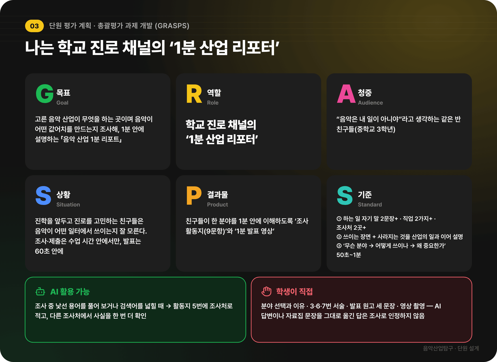

| GRASPS | 내용 |
| --- | --- |
| (G) 목표 | 과제는 내가 고른 음악 산업이 무엇을 하는 곳이며 그 산업에서 음악이 어떤 값어치를 만드는지 조사하여, 1분 안에 설명하는 「음악 산업 1분 리포트」입니다. |
| (R) 역할 | 당신은 학교 진로 채널의 ‘1분 산업 리포터’입니다. |
| (A) 청중 | 당신은 “음악은 내 일이 아니야”라고 생각하는 같은 반 친구들(중학교 3학년)을 설득해야 합니다. |
| (S) 상황 | 당신은 고등학교 진학을 앞두고 진로를 고민하는 친구들이, 음악이 어떤 일터에서 어떻게 쓰이는지 잘 모르는 상황에 있습니다. 조사와 제출은 수업 시간 안에서만, 발표는 60초 안에 끝내야 합니다. |
| (P) 결과물 | 당신은 친구들이 음악 산업 한 분야를 1분 안에 이해할 수 있도록 ‘조사 활동지(9문항)’와 ‘1분 발표 영상’을 만들어야 합니다. |
| (S) 기준 | 결과물은 다음 기준을 만족해야 합니다.<br>① **산업 조사** 하는 일을 자기 말로 두 문장 이상 쓰고, 직업 두 가지 이상을 하는 일과 함께 밝히며, 서로 다른 조사처를 두 곳 이상 적는다.<br>② **음악의 활용 가치** 음악이 쓰이는 장면을 구체적으로 들고, 음악이 없을 때 사라지는 것을 그 산업의 일과 이어 설명한다.<br>③ **발표 수행** ‘무슨 분야인가 → 음악이 어떻게 쓰이는가 → 왜 중요한가’의 세 문장 짜임으로 50초~1분 동안 발표한다. |
| AI 활용 범위 | **AI 활용 가능** 조사 중 낯선 용어를 풀어 보거나 검색어를 넓힐 때. 활용했다면 활동지 5번에 조사처로 적고, 다른 조사처에서 사실을 한 번 더 확인한다.<br>**학생이 직접** 분야 선택과 이유, 3·6·7번 문장 서술, 발표 원고 세 문장, 발표 영상 촬영. AI 답변이나 자료집 문장을 그대로 옮긴 답은 조사로 인정하지 않는다. |

#### 과제 안내문

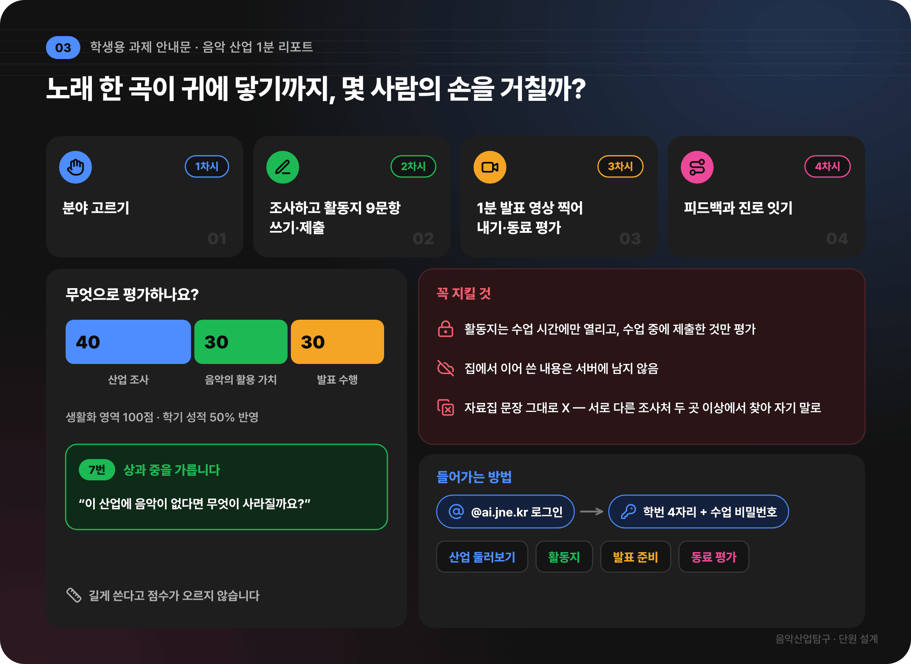

> ### 「음악으로 먹고사는 사람들」 ― 음악 산업 1분 리포트
>
> 노래 한 곡이 여러분 귀에 닿기까지 몇 사람의 손을 거칠까요? 가수와 작곡가 말고도 음악을 옮기고, 지키고, 무대에 올리고, 화면에 입히는 사람들이 있습니다. 이번 과제에서 여러분은 ‘1분 산업 리포터’가 되어 음악 산업 12개 분야 가운데 하나를 골라 조사하고, “음악은 내 일이 아니야”라고 말하는 친구에게 1분 안에 그 분야를 소개합니다.
>
> **■ 무엇을 하나요?** ① 분야 고르기(1차시) → ② 조사하고 활동지 9문항 쓰기 · 제출(2차시) → ③ 1분 발표 영상 찍어 내기 · 동료 평가(3차시) → ④ 피드백과 진로 잇기(4차시)
>
> **■ 무엇으로 평가하나요?** 산업 조사 40점 · 음악의 활용 가치 30점 · 발표 수행 30점 (생활화 영역 100점, 학기 성적 50% 반영). 7번 “이 산업에 음악이 없다면 무엇이 사라질까요?”가 상과 중을 가릅니다. 길게 쓴다고 점수가 오르지 않습니다.
>
> **■ 꼭 지킬 것** 활동지는 수업 시간에만 열리고, 수업 중에 제출한 것만 평가합니다. 집에서 이어 쓴 내용은 서버에 남지 않습니다. 자료집 문장을 그대로 옮기는 것은 조사가 아닙니다. 서로 다른 조사처 두 곳 이상에서 찾아 자기 말로 쓰세요.
>
> **■ 12개 분야** 음원 유통·스트리밍 / 공연 기획·제작 / 음악 저작권 관리 / 음악 교육 / 음악 치료 / 영상 음악 / 게임 음악 / 악기 제조·유통 / 음향 엔지니어링 / 아티스트 매니지먼트 / 음악 저널리즘·평론 / 인공지능 음악 기술
>
> **■ 들어가는 방법** 학교 구글 계정(@ai.jne.kr)으로 로그인 → 학번 네 자리와 수업 비밀번호 입력 → [산업 둘러보기] · [활동지] · [발표 준비] · [동료 평가] 탭

### 3-3. 루브릭

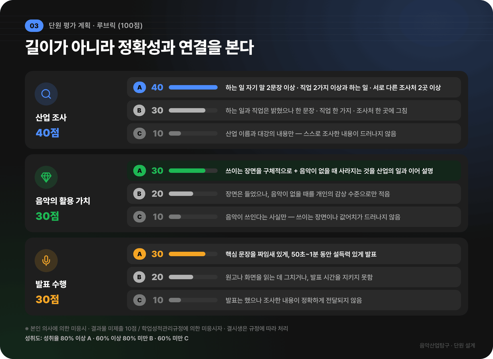

과제 1 — **음악 관련 산업 조사·발표**

| 평가 요소 | 성취수준 | 수행 수준(채점 기준) | 배점 |
| --- | :---: | --- | :---: |
| **산업 조사** (40점) | A | 고른 산업이 무엇을 하는 곳인지 자기 말로 두 문장 이상 기술하고, 그 산업의 직업 두 가지 이상을 하는 일과 함께 밝혔으며, 서로 다른 조사처 두 곳 이상을 제시하였다. | 40 |
| | B | 고른 산업이 하는 일과 직업을 밝혔으나, 기술이 한 문장에 그치거나 직업이 한 가지에 머물거나 조사처가 한 곳이다. | 30 |
| | C | 산업의 이름과 대강의 내용만 적어, 스스로 조사한 내용이 답에 드러나지 않는다. | 10 |
| **음악의 활용 가치** (30점) | A | 음악이 쓰이는 장면을 구체적으로 들고, 음악이 없을 때 사라지는 것을 그 산업의 일과 이어 설명하여 음악의 활용 가치를 스스로 밝혔다. | 30 |
| | B | 음악이 쓰이는 장면은 들었으나, 음악이 없을 때를 개인의 감상 수준으로만 적어 활용 가치가 뚜렷이 드러나지 않는다. | 20 |
| | C | 음악이 쓰인다는 사실만 적고, 쓰이는 장면이나 그 값어치가 드러나지 않는다. | 10 |
| **발표 수행** (30점) | A | 조사한 내용의 핵심 문장을 짜임새를 갖추어, 정해진 시간(50초~1분) 동안 설득력 있게 발표하였다. | 30 |
| | B | 조사한 내용의 핵심 문장을 원고나 화면을 읽는 데 그쳤거나, 발표 시간을 지키지 못하였다. | 20 |
| | C | 발표는 하였으나 조사한 내용이 정확하게 전달되지 않았다. | 10 |

<sub>※ 본인 의사에 의한 미응시 · 결과물 미제출 10점, 학업성적관리규정에 의한 미응시자 · 결시생은 규정에 따라 처리 | 성취도: 성취율 80% 이상 A, 60% 이상 80% 미만 B, 60% 미만 C</sub>

---

## 4. 단원 수업 계획

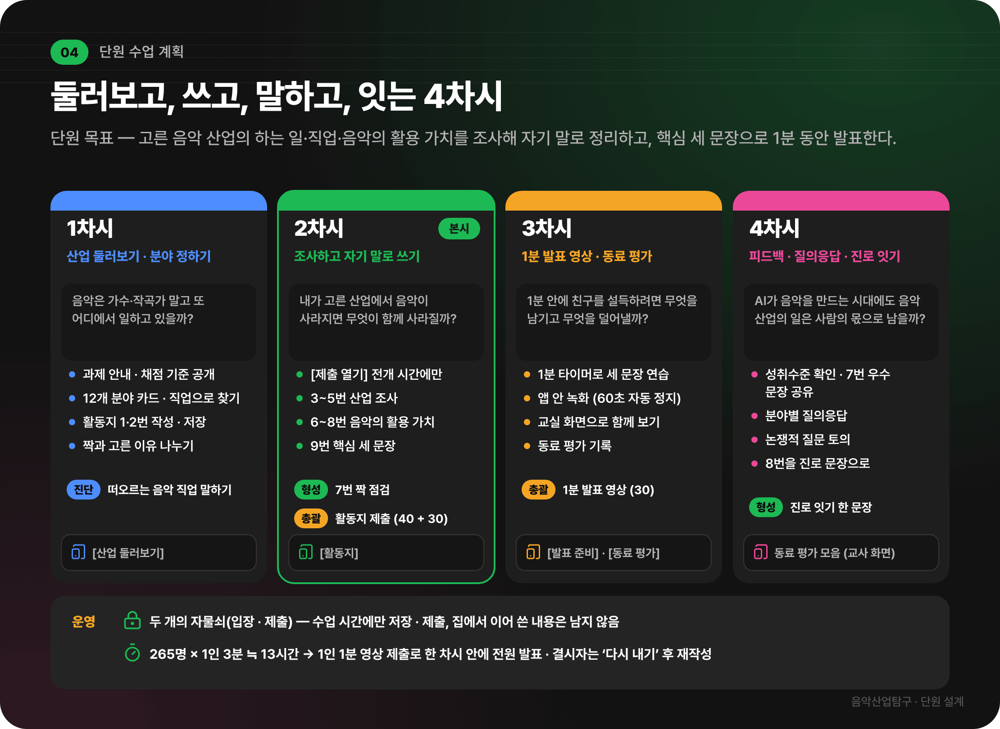

**단원 목표** 고른 음악 산업의 하는 일 · 직업 · 음악의 활용 가치를 서로 다른 조사처에서 조사하여 자기 말로 정리하고, 핵심을 세 문장으로 간추려 1분 동안 설득력 있게 발표할 수 있다.

**평가 방법** &nbsp; ■ 논술 &nbsp; ■ 구술·발표 &nbsp; □ 토의·토론 &nbsp; □ 프로젝트 &nbsp; □ 실험·실습 &nbsp; □ 포트폴리오 &nbsp; □ 실기 &nbsp; □ 기타

| 차시 | 수업 활동 | 평가 활동 (피드백 주체) | AI·디지털 활용 (교사/학생/AI 역할) |
| --- | --- | --- | --- |
| **1차시** | **탐구 질문: 음악은 가수·작곡가 말고 또 어디에서 일하고 있을까?**<br>▪ 음악 산업 둘러보기 · 분야 정하기<br>· 과제 안내문 · 채점 기준 공개(산업 조사 40 · 활용 가치 30 · 발표 30), 7번 문항이 상·중을 가름을 미리 안내<br>· 플랫폼 [산업 둘러보기]에서 12개 분야 카드와 [직업으로 찾기] 탐색<br>· 관심 분야 하나를 골라 활동지 1·2번(고른 분야 · 이유) 작성 후 저장<br>· 짝과 고른 분야와 이유를 한 문장씩 나누기 | **진단** 떠오르는 음악 직업 말하기(가수 · 작곡가 외)<br>• 교사: 저장된 1·2번 확인 → 미선정 학생은 2차시 도입에서 개별 안내<br>• 동료: 고른 이유를 듣고 질문 한 가지 | **수업** 음악 산업 탐구 플랫폼<br>학생 12분야 카드 · 직업 검색 → 교사 [제출 현황]으로 저장 여부 확인 |
| **2차시**<br>(본시) | **탐구 질문: 내가 고른 산업에서 음악이 사라지면 무엇이 함께 사라질까?**<br>▪ 조사하고 자기 말로 쓰기 · 활동지 제출<br>· [제출 열기]로 전개 시간에만 제출 개방(과제형 수행평가 금지 준수)<br>· 3~5번: 하는 일(자기 말 2~3문장) · 직업 2가지 이상과 하는 일 · 서로 다른 조사처 2곳 이상<br>· 6~8번: 음악이 쓰이는 장면 → 음악이 없다면 사라지는 것 → 나와 이어지는 점<br>· 9번: 발표용 핵심 세 문장(무슨 분야인가 / 음악이 어떻게 쓰이는가 / 왜 중요한가) | **형성** 7번 문장 짝 점검(산업의 일과 이어졌는가)<br>**총괄** 활동지 제출(산업 조사 40 · 활용 가치 30)<br>• 교사: 순회하며 “친구에게 말로 설명해 볼래?”로 자기 말 바꾸기 코칭<br>• 동료: 서로의 7번을 소리 내어 읽고 확인 질문 한 가지 | **수업 · 평가** 플랫폼 활동지 · 수업 통제<br>교사 제출 개방 · 실시간 현황 → 학생 웹 조사 · 자동 저장 → 서버 제출 시각 자동 기록 |
| **3차시** | **탐구 질문: 1분 안에 친구를 설득하려면 무엇을 남기고 무엇을 덜어낼까?**<br>▪ 1분 발표 영상 찍기 · 함께 보며 동료 평가<br>· [발표 준비] 탭에서 9번 세 문장을 1분 타이머로 연습<br>· 앱 안에서 바로 녹화(60초 자동 정지) → 다시 보기 · 다시 찍기 → [이 영상 내기]<br>· 교실 화면으로 발표 영상을 차례로 함께 보기<br>· [동료 평가] 탭에 이해도 · 인상 깊은 점 · 더 궁금한 점 기록 | **총괄** 1분 발표 영상(발표 수행 30)<br>• 자기: 찍은 영상을 보고 마음에 들 때까지 다시 찍기<br>• 동료: 이해도 · 인상 깊은 점 · 궁금한 점(성적 미반영) | **평가** 앱 안 녹화 · 발표 영상 수합<br>학생 촬영 · 제출 → 교사 드라이브 학급별 폴더로 수합, [첫 번째부터 틀기]로 상영 |
| **4차시** | **탐구 질문: AI가 음악을 만드는 시대에도 음악 산업의 일은 사람의 몫으로 남을까?**<br>▪ 피드백 · 질의응답 · 진로 잇기<br>· 채점 결과와 성취수준 확인, 7번 우수 문장 익명 공유(“음악이 사라지면 ___이 사라진다”)<br>· 동료 평가의 ‘더 궁금한 점’으로 분야별 질의응답<br>· 논쟁적 질문 토의: ‘인공지능 음악 기술’ 분야와 다른 분야의 일을 견주어 보기<br>· 8번(나와 이어지는 점)을 진로 문장으로 다시 쓰기 | **형성** 진로 잇기 한 문장(성찰)<br>• 교사: 성취수준별 개별 피드백(상·중을 가른 7번 중심)<br>• 동료: 받은 질문에 답하며 조사 내용 보완 | **수업** 동료 평가 모음(교사 화면)<br>교사 궁금한 점을 분야별로 묶어 토의 자료로 재구성 → 학생 답변 · 보완 |
| **운영** | ▪ 두 개의 자물쇠(입장 · 제출): 수업 시간에만 서버에 저장 · 제출되어 집에서 이어 쓴 내용은 남지 않음 → 과제형 수행평가 금지 요건 충족<br>▪ 265명 × 1인 3분 현장 발표 ≒ 13시간 → 1인 1분 영상 제출로 한 차시 안에 전원 발표 / 결시자는 ‘다시 내기’ 허용 후 재작성 | | |

<p align="center">
  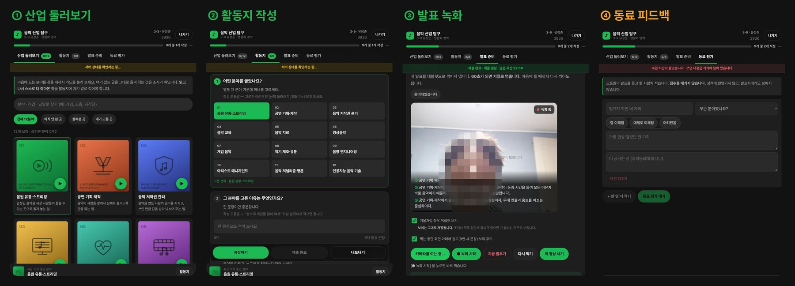
  <br><sub>학생 화면(태블릿)의 네 탭 — ① 산업 둘러보기 ② 활동지 ③ 발표 녹화 ④ 동료 평가</sub>
</p>

<p align="center">
  
  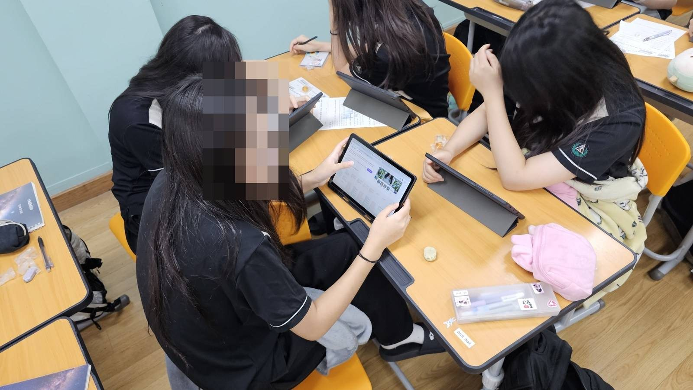
  <br><sub>태블릿으로 고른 분야 조사 · 제출 &nbsp;|&nbsp; 1분 발표</sub>
</p>

---

## 5. 본시 수업 설계

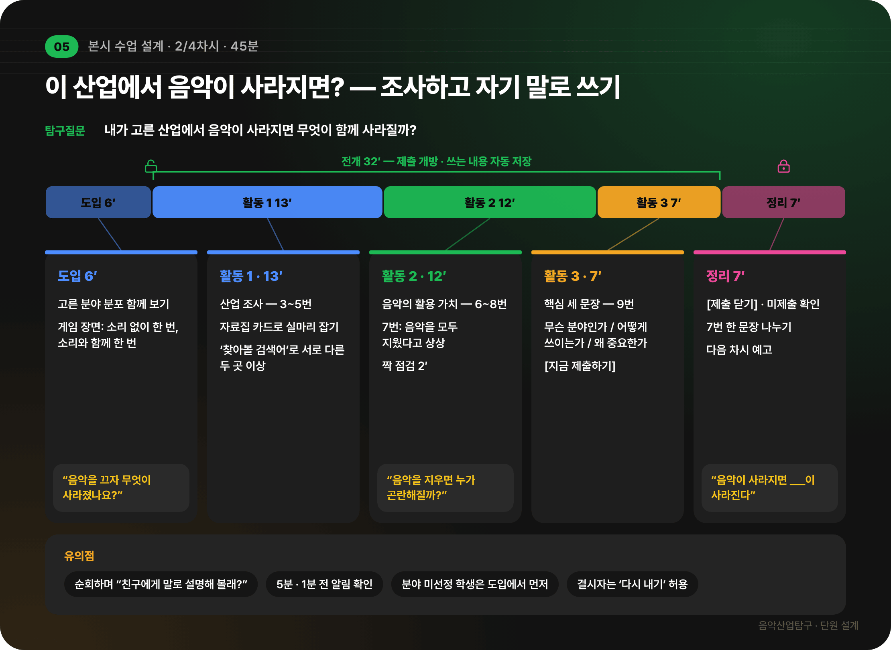

| 항목 | 내용 |
| --- | --- |
| 주제 | 이 산업에서 음악이 사라지면? ― 조사하고 자기 말로 쓰기 |
| 차시 | 2 / 4 |
| 단원 수준의 핵심 아이디어 | 음악은 산업 속에서 사람의 감정과 경험을 설계하는 값어치를 만들며, 그 값어치를 이해하는 일은 음악과 관련된 진로의 폭을 넓힌다. |
| 성취기준 | [9음03-02] 음악과 관련된 산업에 대해 조사하여 발표한다. |
| 탐구질문 (학습목표) | **탐구질문** 내가 고른 산업에서 음악이 사라지면 무엇이 함께 사라질까?<br>**학습목표** 고른 음악 산업의 하는 일과 직업을 서로 다른 두 곳 이상에서 조사하여 자기 말로 정리하고, 음악의 활용 가치를 그 산업의 일과 이어 설명할 수 있다. |

| 단계 (분) | 교수·학습 활동 | 자료(㉶) · 유의점(※) |
| --- | --- | --- |
| **도입**<br>(6′) | ▣ **전시 확인 · 동기 유발**<br>◦ 1차시에 고른 분야 분포를 교사 화면으로 함께 보기<br>◦ 게임 장면을 소리 없이 한 번, 소리와 함께 한 번 보기<br>&nbsp;&nbsp;- “음악을 끄자 무엇이 사라졌나요?”<br>▣ **탐구 질문 · 채점 기준 확인**<br>◦ 탐구 질문 제시: 내가 고른 산업에서 음악이 사라지면 무엇이 함께 사라질까?<br>◦ 7번 문항이 상·중을 가름 ― 길게 쓴다고 점수가 오르지 않음<br>&nbsp;&nbsp;- 자료집 문장을 그대로 옮기면 조사가 아님, 조사처는 두 곳 이상 | ㉶ 교사용 화면(수업 통제 · 제출 현황), 게임 장면 영상<br>※ 분야를 고르지 못한 학생은 도입에서 먼저 확인 |
| **전개**<br>(32′) | **탐구질문: 내가 고른 산업에서 음악이 사라지면 무엇이 함께 사라질까?**<br>**[활동 1] 산업 조사하기 (13′) ― 활동지 3~5번**<br>- [제출 열기]: 전개 32분 동안 제출 개방, 쓰는 내용은 자동 저장<br>- 자료집 카드(무슨 일을 하나요 → 일의 흐름 → 직업)로 실마리를 잡고, ‘찾아볼 검색어’로 서로 다른 두 곳 이상 조사<br>- 3번 하는 일(자기 말 2~3문장) · 4번 직업 2가지 이상과 하는 일 · 5번 조사처<br>**[활동 2] 음악의 활용 가치 밝히기 (12′) ― 6~8번**<br>- 6번: 음악이 쓰이는 구체적 장면 쓰기<br>- 7번: 음악을 모두 지웠다고 상상하기 → 무엇이 밋밋해지고 누가 곤란해지는지 그 산업의 일과 이어 쓰기<br>- 짝 점검(2′): 서로의 7번을 소리 내어 읽고 “산업의 일과 이어졌나?” 확인<br>- 8번: 이 분야와 나를 이어 주는 점<br>**[활동 3] 발표용 핵심 세 문장 (7′) ― 9번**<br>- ① 무슨 분야인가 ② 음악이 어떻게 쓰이는가 ③ 왜 중요한가<br>- [지금 제출하기] → ‘제출 완료’ 띠 확인 (시간이 다 되면 자동 제출) | ㉶ 개인 태블릿, 음악 산업 탐구 플랫폼(산업 둘러보기 · 활동지)<br>※ 순회하며 “친구에게 말로 설명해 볼래?”로 자기 말 바꾸기 돕기<br>※ 7번에서 막히면 “음악을 지우면 누가 곤란해질까?”로 되묻기<br>※ 5분 · 1분 전 알림 확인 |
| **정리**<br>(7′) | ▣ **제출 확인**<br>◦ [제출 닫기] → 미제출 명단 확인<br>&nbsp;&nbsp;- 수업 밖에서 이어 쓴 내용은 서버에 남지 않음을 다시 안내<br>▣ **나누기 · 차시 예고**<br>◦ 희망자 2~3명 7번 한 문장 나누기: “음악이 사라지면 ___이(가) 사라진다”<br>&nbsp;&nbsp;- 다음 차시: 9번 세 문장으로 1분 발표 영상 찍기 · 동료 평가 | ㉶ 교사용 화면(제출 현황)<br>※ 결시자는 ‘다시 내기’를 허용해 별도 시간에 재작성 |

<p align="center">
  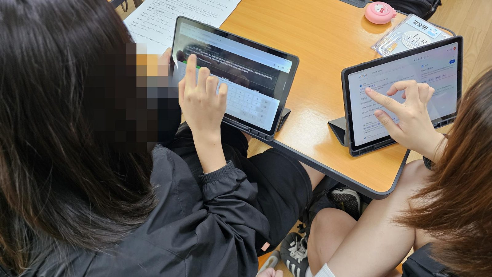
  <br><sub>[활동 1] 서로 다른 조사처 두 곳 이상에서 조사하기</sub>
</p>

---

## 폴더 구성

```
unit-design/
├─ README.md                 ← 이 문서
└─ assets/
   ├─ illust/                ← 문단별 요약 일러스트 (PNG, 55.5 : 40.5)
   │  └─ svg/                ← 일러스트 원본 (SVG, 수정용)
   └─ photos/                ← 수업 사진 · 플랫폼 화면
```

<sub>
일러스트는 음악 산업 탐구 플랫폼의 색(배경 #121212 · 포인트 #1DB954)에 맞춰 그렸습니다. 아이콘: <a href="https://lucide.dev">Lucide</a> (ISC License) · 글꼴: Pretendard (SIL OFL 1.1).<br>
수업 사진은 2026 학교예술교육 실천사례 연구보고서에 실린 사진이며, 학생 얼굴은 모자이크 처리되어 있습니다.
</sub>
