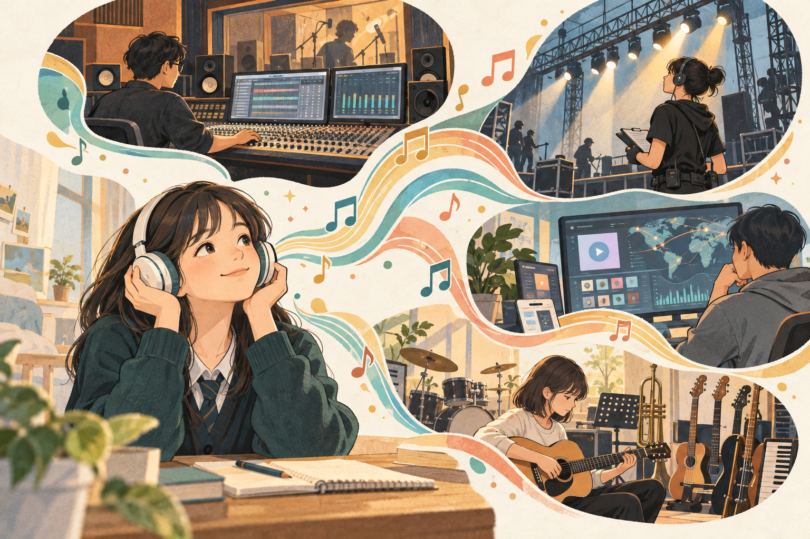
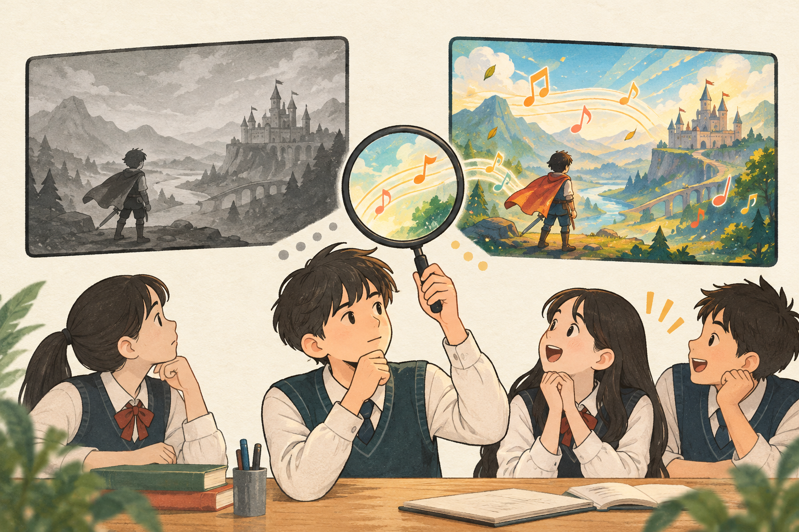
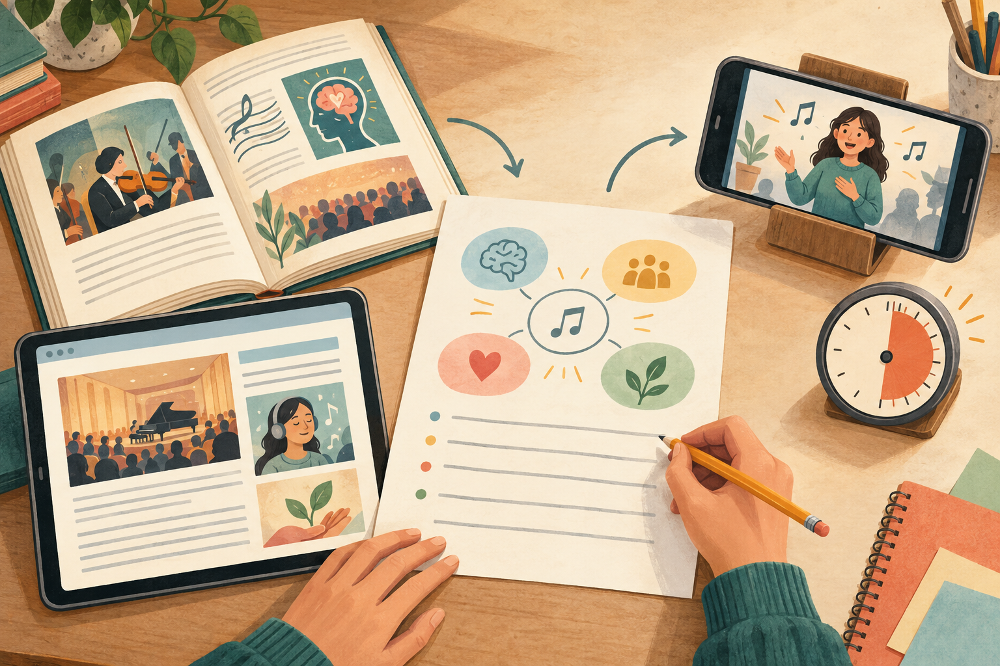
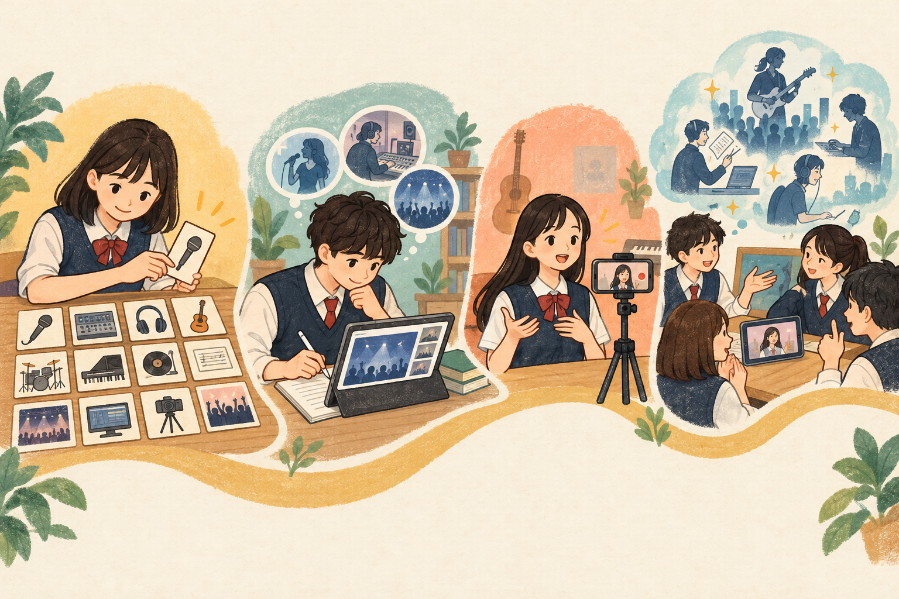
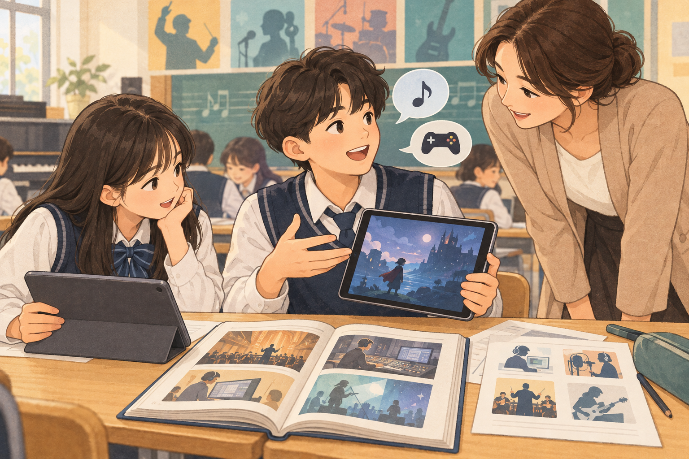

# 일러스트 제작 기록

제작일: 2026-10-10. 제작 도구: 내장 image_gen(기본 도구 방식). 모든 이미지는 실제 수업 사진이 아닌 개념 설명용 AI 생성 일러스트입니다. 추가 API·CLI는 사용하지 않았습니다.

따뜻한 종이 질감과 청록·황토·산호색을 공통으로 사용하고, 핵심 개념은 문서의 한글 설명과 연결했습니다. 최종 파일은 `assets/illustrations/`에 보관했습니다.

## 01-purpose



**최종 생성 프롬프트**

```text
Use case: illustration-story. Create a refined editorial educational illustration for a Korean middle-school music unit README. Wide landscape 3:2, warm ivory background, muted teal, ochre and coral, subtle paper grain, friendly hand-drawn shapes, generous margins. Scene: a Korean teenage student wearing headphones discovers the people behind everyday music: a sound engineer at mixing desk, stage planner beside theatre lights, streaming distribution screen, musical instruments. A flowing musical ribbon connects listener and four workplaces. Convey music as real work and a possible future, not only singers. No text, letters, logos or watermark. This is a conceptual illustration, not a photograph.
```

## 02-inquiry



**최종 생성 프롬프트**

```text
Use case: illustration-story. Refined educational editorial illustration, landscape 3:2, warm ivory paper, muted teal ochre coral, hand drawn shapes and gentle texture. Korean middle school students compare two identical game-screen scenes side by side, one silent and emotionally flat in gray, the other with musical notes and expressive dynamic atmosphere in color. A thoughtful student uses a magnifying glass between the screens to investigate what music contributes to an industry. Clear visual focus, few objects, generous margins. No text, letters, logos, numbers or watermark.
```

## 03-evidence



**최종 생성 프롬프트**

```text
Use case: illustration-story. Refined educational editorial illustration, landscape 3:2, warm ivory paper, muted teal ochre coral, hand drawn shapes and gentle texture. An overhead desk scene showing two distinct research sources (open book and website on tablet) leading to a student handwritten worksheet, then a phone on a small stand showing a student giving a presentation, alongside a one-minute circular timer. Three visual groups: research, explaining music's value, communicating. Simplified empty lines, no readable text, no letters, logos or watermark. Generous margins.
```

## 04-journey



**최종 생성 프롬프트**

```text
Use case: illustration-story. Refined educational editorial illustration, landscape 3:2, warm ivory paper, muted teal ochre coral, hand drawn shapes and gentle texture. A continuous winding path connects four clear miniature scenes from a Korean middle-school music unit: choosing a music-industry card from a grid of twelve cards; researching with a tablet and writing one's own explanation; recording a brief talk on a phone on a tripod; sharing peer feedback and imagining future music careers. Four scenes equally prominent in a simple left-to-right progression, no text, letters, numbers, logos or watermark.
```

## 05-lesson



**최종 생성 프롬프트**

```text
Use case: illustration-story. Refined educational editorial illustration, landscape 3:2, warm ivory paper, muted teal ochre coral, hand drawn shapes and gentle texture. Korean middle-school classroom close view: two students use tablets, an open reference book and worksheets to investigate music-related jobs. One explains a game audio example to their partner with simple speech bubbles containing a musical note and a game controller; a teacher leans in to listen and coach the student to explain in their own words. Friendly respectful classroom, uncluttered composition, no readable text, letters, logos or watermark.
```

## 06-feedback


**최종 생성 프롬프트**

```text
Use case: illustration-story. Refined educational editorial illustration, landscape 3:2, warm ivory paper, muted teal ochre coral, hand drawn shapes and gentle texture. Three Korean middle-school students view a classmate's recorded music-industry presentation on a tablet, exchange question cards, revise a worksheet, and look toward a branching path with musical career objects: mixing console, stage lights and a small abstract AI chip beside a human hand and musical notes. Emphasize reflection, constructive feedback and human choice in future careers. No readable text, letters, numbers, logos or watermark.
```

