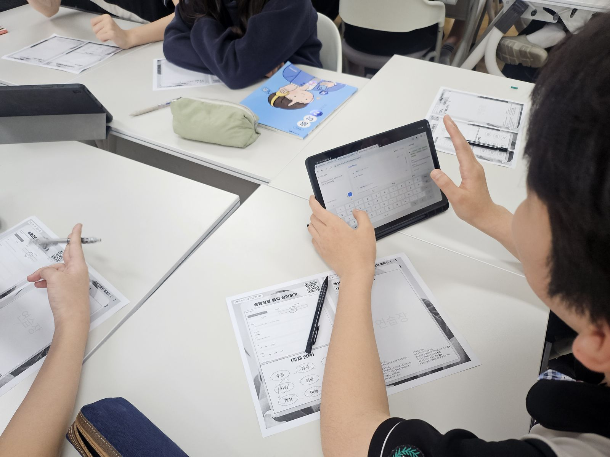
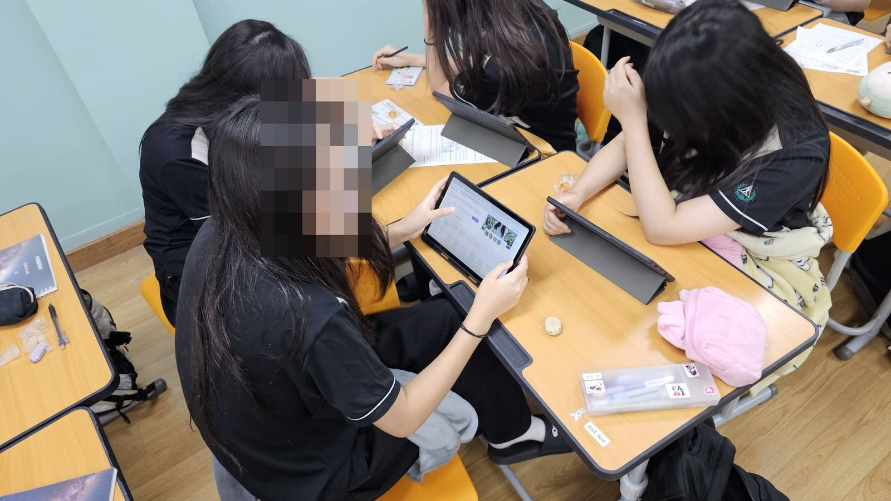

# 관련 사진·화면 자료

[단원 소개](../README.md) · [상세 설계안](unit-plan.md) · [전체 출처 기록](sources.md)

사용자가 제공한 「2026_학교예술교육_실천사례_연구보고서(제출용 창A안).hwp」에서 골랐습니다. 기존 자료에 들어 있던 이미지를 추출했으며, 원본의 모자이크를 유지했습니다. **아래 사진은 관련 음악 교육활동 자료이며, 이 4차시 설계안의 실제 실시 장면으로 별도 확인한 것은 아닙니다.**

## 1. 태블릿과 활동지를 함께 활용하는 음악 수업

종이 활동지와 태블릿을 함께 활용하는 학습 환경입니다. 원자료의 활동지에는 음악 창작 활동이 나타납니다. 본 단원의 ‘디지털 도구를 활용하고 자기 말로 작성하기’와 연결해 볼 수 있는 환경 자료로 첨부했습니다.

출처: 연구보고서 내장 이미지 `BIN0097.jpg`.

## 2. 디지털 음악 자료를 활용하는 교실

학생들이 모둠 자리에서 태블릿을 활용하는 장면입니다. 본 설계안의 개인 탐구와 짝·동료 소통이 함께 이루어지는 교실 환경을 설명하는 데 연결했습니다. 원본에 적용된 얼굴 모자이크를 그대로 보존했습니다.

출처: 연구보고서 내장 이미지 `BIN003E.jpg`.

## 3. 태블릿 기반 모둠 활동

태블릿과 종이 자료를 함께 활용하는 모둠 활동 장면입니다. 본 단원의 짝 점검과 동료 질문 활동에 대한 관련 환경 자료로 활용할 수 있습니다. 실제 대화 내용이나 수행 과제는 사진만으로 단정하지 않았습니다.

출처: 연구보고서 내장 이미지 `BIN003F.jpg`.

## 4. 음악 산업 탐구 플랫폼 · 산업 둘러보기

연구보고서에 실린 ‘음악 산업 탐구’ 학생용 화면입니다. 산업 둘러보기·활동지·발표 준비·동료평가 탭과 분야별 카드를 확인할 수 있습니다. **보고서 작성 당시의 화면 기록**이며, 현재 배포 상태나 서버 동작을 확인한 화면은 아닙니다.

출처: 연구보고서 내장 이미지 `BIN003B.jpg`. 화면에 표시된 계정은 원자료 그대로이며 설계안 작성자 이름으로 표시되어 있습니다.

---

추출 이미지에는 새로 인물을 추가하거나 배경·얼굴을 편집하지 않았습니다. 사진·화면의 권리와 공개 범위는 원자료를 따르며, 이 묶음에 별도의 공개 라이선스를 임의로 부여하지 않았습니다.
